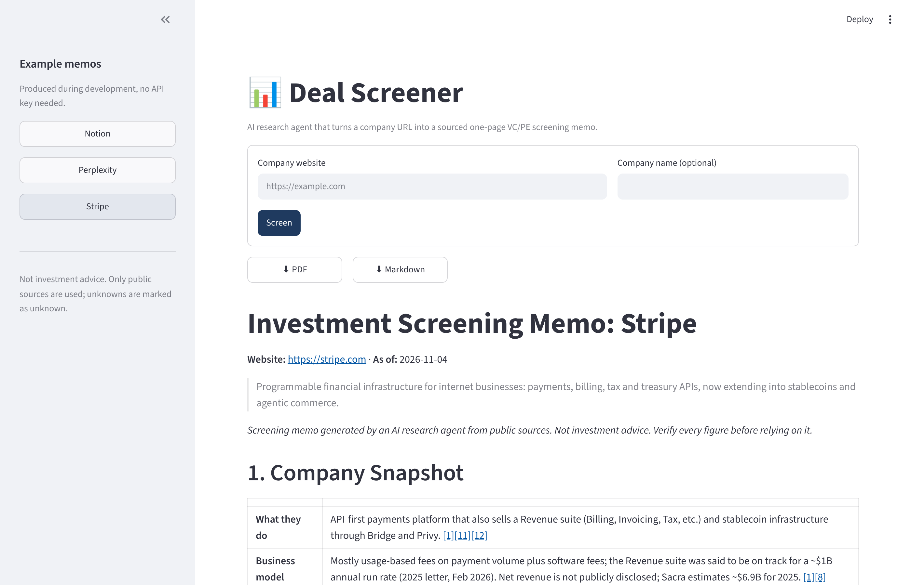
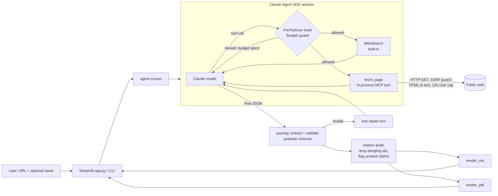

# Deal Screener

**An AI research agent that turns a company URL into a sourced, one-page investment screening memo for VC and PE investors.**

Paste a website, click *Screen*, and a Claude agent reads the company site, searches for funding,
news and competitors, and writes a memo with the sections an investment committee expects:
snapshot, market and competition, thesis, risks and red flags, potential acquirers, questions for
management, and sources. Every factual claim links to its source. Anything the agent cannot find
is marked *Unknown*, and claims without a source are flagged *(unverified)*. It handles first-pass
screening, which usually takes an analyst 1–2 hours, in a few minutes. The analyst still makes the
call.


<sub>Screenshot: the Streamlit UI showing an example memo. Replace with a GIF of a live run once deployed.</sub>

**Example output:** [Stripe](examples/stripe.md) · [Notion](examples/notion.md) · [Perplexity](examples/perplexity.md) (Markdown, PDF and JSON for each in [`examples/`](examples/)).

---

## Quick start (3 commands)

```bash
pip install -e ".[ui]"
```

```bash
export ANTHROPIC_API_KEY=sk-ant-...      # or: cp .env.example .env and edit it
```

```bash
streamlit run app.py                      # or: python -m deal_screener https://stripe.com
```

The CLI writes `memos/<company>.md`, `.json` and `.pdf` and streams progress to stderr:

```text
▶ Screening https://stripe.com with claude-sonnet-5-5
🔎 Searching: Stripe funding round valuation 2026
📄 Reading: https://stripe.com/newsroom
...
✅ Done: 18 tool calls, ~210,000 tokens
memos/stripe.md
```

Re-render an existing memo without an API call: `python -m deal_screener --render examples/stripe.json`.

## Architecture



### How the agent loop works

1. **Setup.** `agent.screen()` builds a `ClaudeSDKClient` with a system prompt (research plan +
   evidence rules + JSON schema), two tools only (`WebSearch` and our `fetch_page`), no local
   settings, no file or shell access.
2. **Research.** Claude decides what to search and read: company site first, then funding,
   recent news (including negative news), competitors. Each tool call streams to the UI as a
   progress line.
3. **Guardrails.** Every tool call passes a `PreToolUse` hook backed by a `Budget` object.
   - *Tool calls* (soft limit): once `DEAL_SCREENER_MAX_TOOL_CALLS` is reached, further calls are
     denied with the message "budget exhausted, write the memo now with what you have". The agent
     finishes gracefully instead of crashing.
   - *Tokens* (hard limit): usage is summed per API response. At 80% of `DEAL_SCREENER_MAX_TOKENS`
     tools are denied; above 100% the run is interrupted with a clear error.
   - *Cost* (optional): `DEAL_SCREENER_MAX_BUDGET_USD` is passed to the SDK as a hard ceiling.
   - `max_turns` is set as a backstop.
4. **Structured output.** The final reply is one JSON object. `parsing.py` extracts it (fenced or
   bare), validates it against a pydantic schema and, if it fails, asks the agent once to repair it.
5. **Citation audit.** Citations pointing at non-existent sources are removed. Factual claims with
   no source are rendered with an *(unverified)* tag. "Unknown" is an accepted answer.
6. **Rendering.** The same `Memo` object is rendered to Markdown (UI, GitHub) and PDF (reportlab).

## Configuration

All settings come from environment variables (or `.env`, or Streamlit secrets). The API key is
never read from anywhere else and never logged; `Settings.__repr__` hides it.

| Variable | Default | Meaning |
|---|---|---|
| `ANTHROPIC_API_KEY` | (required) | Anthropic API key. A missing key fails fast with a clear message. |
| `DEAL_SCREENER_MODEL` | `claude-sonnet-5-5` | Any Claude model id. |
| `DEAL_SCREENER_MAX_TOOL_CALLS` | `25` | Searches plus page reads per run. |
| `DEAL_SCREENER_MAX_TOKENS` | `400000` | Input + cache-write + output tokens per run (cache reads excluded). |
| `DEAL_SCREENER_MAX_BUDGET_USD` | empty | Optional hard cost ceiling per run. |

## Deploy to Streamlit Community Cloud

1. Push this repo to GitHub (public or private).
2. On [share.streamlit.io](https://share.streamlit.io), choose **Create app**, select the repo and
   branch, and set the main file to `app.py`. Dependencies come from `requirements.txt`.
3. Under **Advanced settings → Secrets**, paste:
   ```toml
   ANTHROPIC_API_KEY = "sk-ant-..."
   DEAL_SCREENER_MAX_BUDGET_USD = "2"
   ```
4. Deploy. The example memos in the sidebar work without a key, so visitors can see output
   before anyone pays for a run.

> A public deployment spends your API credits for every visitor's run. Set
> `DEAL_SCREENER_MAX_BUDGET_USD`, keep the app private, or add a password in front of it before
> sharing the link widely.

## Project structure

```text
deal_screener/
  agent.py        agent loop: SDK options, streaming, budget hook, repair turn
  prompts.py      system prompt + JSON schema (single source of truth)
  tools.py        fetch_page tool: URL checks, SSRF guard, HTML to text
  guardrails.py   Budget: tool-call and token limits
  models.py       pydantic memo schema
  parsing.py      JSON extraction, validation, citation audit
  render_md.py    Markdown renderer
  render_pdf.py   PDF renderer (reportlab)
  config.py       env-based settings, clear missing-key error
  cli.py          python -m deal_screener
app.py            Streamlit UI
examples/         three sample memos (md, pdf, json)
tests/            pytest suite, agent mocked; no network or key needed
```

## Tests

```bash
pip install -e ".[dev]" && pytest -q
```

55 tests cover JSON extraction, schema validation, the citation audit, Markdown and PDF
rendering, budget limits, settings, HTML parsing, the SSRF guard, the CLI, and the full agent loop
against a fake SDK client (happy path, denied tool calls, repair turn, token-limit interrupt, API
errors). CI runs them on Python 3.11 and 3.13.

## Design decisions

- **Claude Agent SDK, not a hand-rolled loop.** The SDK provides the tool loop, the built-in
  WebSearch tool, hooks and cost tracking. Our code covers what is domain-specific: what to
  research, how to check it, how to present it.
- **Our own `fetch_page` instead of the built-in WebFetch.** WebFetch returns a model-written
  summary of the page. `fetch_page` returns the page's actual text, so the agent cites what the
  page says. It also lets us enforce timeouts, a 2 MB download cap, a 12k character cap (which
  protects the token budget), and an SSRF guard that blocks localhost and private IPs (relevant
  for a hosted app).
- **JSON first, then deterministic rendering.** The model fills in a schema; Python renders it.
  This keeps the memo format identical across runs, makes citations checkable in code, allows
  Markdown and PDF from one object, and makes the formatting testable without an API.
- **Make uncertainty visible.** A screening memo with an invented number is worse than one with
  "Unknown". The prompt asks for Unknown, the audit flags uncited claims, and the disclaimer is
  part of every memo.
- **Soft tool limit, hard token limit.** Cutting a run off at tool call N would waste the
  research done so far. Denying further tools makes the agent write the memo with what it has.
  Tokens are the real cost driver, so they get the hard stop.
- **Cache reads are excluded from the token count.** Each turn re-reads the cached conversation.
  Counting those reads would hit the limit after a few turns without reflecting real cost (cache
  reads are billed at about a tenth of the input price). The optional USD ceiling covers total cost.
- **Default model `claude-sonnet-5-5`.** The brief asked for `claude-sonnet-5`. At the time of
  writing, the verified Sonnet model id is `claude-sonnet-5-5`, so that is the default. Change it
  with `DEAL_SCREENER_MODEL`.
- **No database, login or queue.** One run produces one memo. Files and downloads are enough for
  this scope.
- **No python-dotenv.** A 15-line `.env` loader avoids a dependency, and it never overrides real
  environment variables.

## Limitations

- **Public information only.** Private-company financials are mostly estimates (Sacra, press
  leaks). The memo labels them as estimates but cannot verify them.
- **Pages that need JavaScript, logins or paywalls** come back thin. The agent then relies on
  search snippets.
- **The citation audit checks structure, not meaning.** It verifies that a claim cites a real
  source. It does not verify that the source supports the claim; that still needs a human
  spot-check.
- **One-page target.** The memo body fits about one page. With 20+ sources, the PDF runs to 2–3
  pages including the sources list.
- **Examples were not produced by a live run.** The build environment had no API key, so they
  were researched with the same prompt and schema and rendered with this code. See
  [examples/README.md](examples/README.md).
- **Each Streamlit run blocks its session** for a few minutes. That is fine for a single user, but
  there is no job queue.

## Roadmap

- [ ] LLM verification pass: re-read each cited source and check that it supports the claim.
- [ ] Deeper sources: Crunchbase or PitchBook APIs, SEC EDGAR, Companies House, job postings for
      headcount trends.
- [ ] Fund-specific screening criteria (thesis fit score, check-size fit) loaded from a YAML file.
- [ ] Batch mode: screen a CSV of URLs and output a ranked pipeline table.
- [ ] Memo diffing: re-screen a company monthly and highlight what changed.
- [ ] Export to Notion or Google Docs; add a password gate for the hosted demo.

## License

[MIT](LICENSE). Example memos use public information only and are not investment advice.
